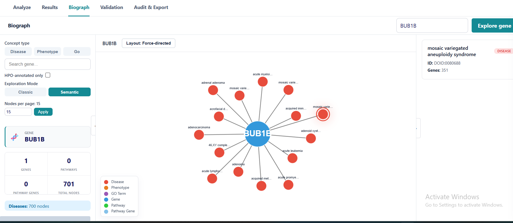
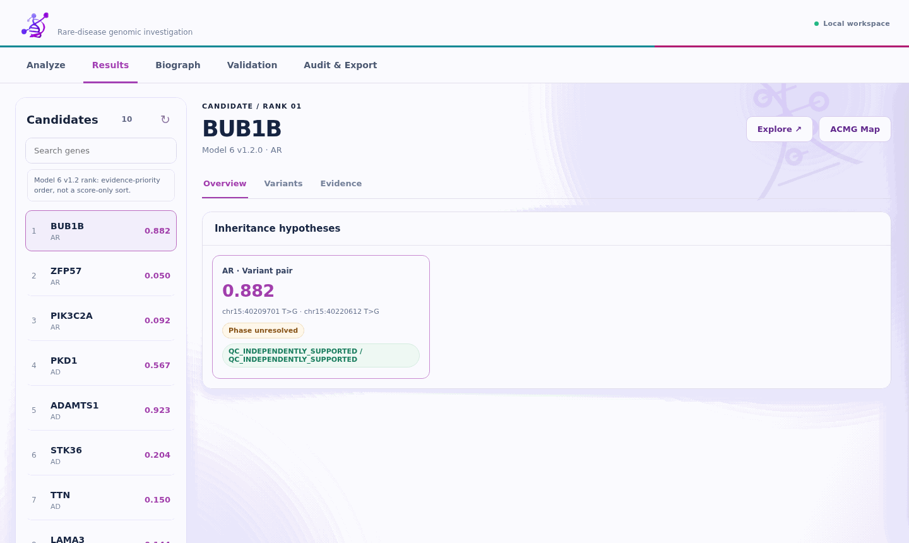
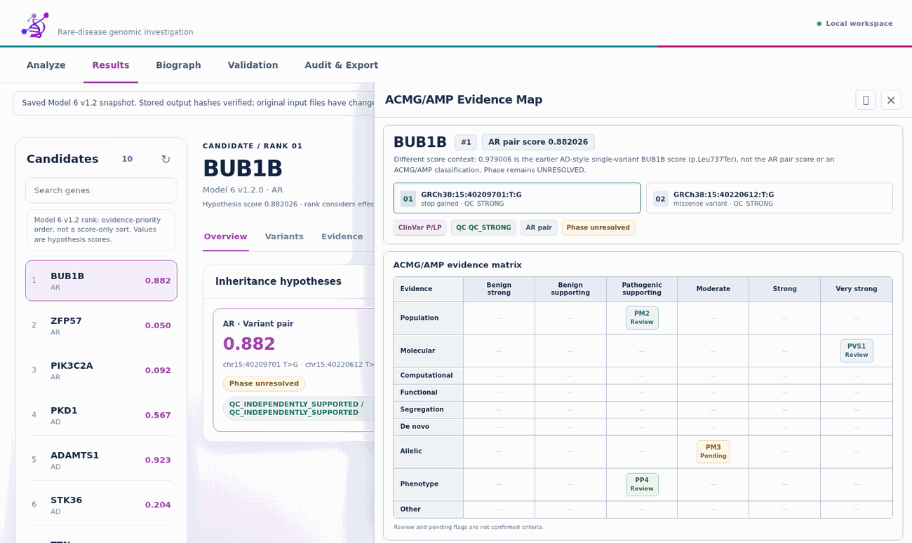

# MVA Genome Explorer — Hackathon submissions

## Explore the submissions

| Track | Methods | Results |
|---|---|---|
| **Track 1 — Variant prioritisation** | [Methods workbook](submissions/track1/methods/UscBen45_Track1_Methods_Description.xlsx) | [Results and availability](submissions/track1/results/) |
| **Track 2 — Mechanism-informed drug repurposing** | [Methods workbook](submissions/track2/methods/UscBen45_Track2_Methods_Description.xlsx) | [Results and availability](submissions/track2/results/) |

## BioGraph — visual exploration

[**See all three BioGraph screenshots (Classic pathways, Semantic diseases, and BUB3 GO terms) →**](assets/biograph/README.md)

## Model 6 v1.2 — ranked candidates and score context

**Gene rank is evidence-based, not a descending sort of the displayed score.** Model 6 v1.2 prioritises effect class and gene–phenotype evidence, with QC, gene–disease support and variant evidence informing subsequent decisions. The displayed logistic value describes the **selected inheritance hypothesis**.

**BUB1B Rank 1:** the two-variant **AR candidate-pair score is 0.882026**; phase remains **UNRESOLVED**. The **0.979006** shown in an earlier ACMG/AMP review screenshot refers instead to the *p.Leu737Ter AD-style single-variant score*—**not an ACMG/AMP classification or a newer final model score**.

**Record clarification:** the 18 October frozen ranking and 19 October audited candidate CSV list **BUB1B, ZFP57, PIK3C2A, PKD1, ADAMTS1, STK36, TTN, LAMA3, GHRHR, PEG3**. The later Track 1 report illustrates this order (including ADAMTS1 at rank 5). An earlier six-stage report listed a different Top 10; its historical results are preserved. The 22 October portal upload is recorded by filename, but **its exact bytes have not been independently confirmed**. [Full provenance comparison](docs/MODEL6_V1_2_RECONCILIATION.md).

*Updated Results view: ranking and hypothesis scores are explicitly distinguished. Where source inputs have changed, saved results are labelled historical, not freshly recalculated.*

*ACMG/AMP review view: the AR-pair score and earlier single-variant score refer to different hypotheses; neither is a clinical classification.*

## Reproducibility and data sharing

[Installation status](INSTALLATION.md) · [Data availability and restrictions](DATA_AVAILABILITY.md)

The repository currently contains a partial software release, not a validated one-command installation. No open-source license is granted. Do not distribute patient-level genomic files without appropriate authorization.

---

Research software and methods supporting two complementary submissions:

- **Track 1: Variant prioritisation** — genomic annotation, technical QC, inheritance-aware candidate assessment, transparent ranking and ACMG/AMP evidence review.
- **Track 2: Mechanism-informed drug repurposing** — analysis of BUB1B/BUBR1 variants, network-based biological interpretation and literature-derived pharmacological hypotheses.

## Interpretation and limitations

The BUB1B p.Leu737Ter variant is a predicted loss-of-function allele; p.Asn1002Lys is a missense VUS. The two heterozygous variants have unresolved phase. Proposed interventions, including premature-stop readthrough, NAD+-pathway support and 4-PBA, remain hypotheses: rescue efficacy and safety have not been experimentally established. BioGraph is a separate post-ranking interpretation service and does not modify prioritisation scores. The ACMG/AMP-style evidence map highlights criteria requiring expert review and is not a clinical classifier.

## Reproducibility and data safety

Only task-relevant, reviewed code, methods, configuration and tests should be committed. Patient VCF files, identifiable data, giant reference datasets, caches, virtual environments, backup versions and incidental local results are intentionally excluded. Reference resources and authorised example input datasets will be needed to reproduce full-genome runs. No genomic dataset is included in this initial repository documentation.

## AI assistance

Parts of software development and writing involved AI assistance. See each track's methods disclosure for provider, plan/tier and applicable data-handling settings.

## Source-code release status

Core research Python modules, preliminary tests, track-specific overview files and dependency requirements have been uploaded. The full original methods workbooks, reference resources, complete BioGraph source and end-to-end reproduction bundle are **not yet uploaded**. This is a partial research-code release, not yet a verified end-to-end reproduction package.

For local tests, create a Python 3.12 virtual environment, install `requirements.txt`, and run `python -m pytest tests/test_core.py tests/test_inheritance.py tests/test_acmg_preview.py`. Full application startup will require further source modules and external resources.

## Model 6 v1.2.0 — current application source and results provenance

The public `mva_explorer/` directory now includes a snapshot of the locally installed Model 6 v1.2 backend and browser interface (active ranking router, scoring/mechanism modules, evidence and inheritance helpers, compatibility/annotation/validation routes, QC and statistics). It is a **data-free source snapshot**, not a portable end-to-end deployment: gated WGS, reference indexes, saved evidence matrices, certain private analysis outputs and the separate BioGraph service are not included. The local Model 6 tests passed 43 targeted checks on 1 November 2026; an independent clean-clone end-to-end run has not been verified.

**Important provenance distinction:** the 18 October 2026 active application snapshot and a separately consolidated six-stage report describe different Top 10 gene orders. The saved 22 October CSV is recorded as a saved copy, **not an independently verified copy of the exact Hugging Face portal-uploaded file**. See [Model 6 v1.2 reconciliation](docs/MODEL6_V1_2_RECONCILIATION.md) and [saved candidate CSV](submissions/track1/results/UscBen45_Track1_Model6_v1.2_saved_2026-10-22.csv) before quoting a specific Top 10.

### Track 2 literature and hypotheses

- [Exact original PubMed query, searched 14 October 2026](docs/research/PUBMED_EXACT_SEARCH_2026-10-14.md).
- [Preliminary scoping evidence register — pending completion](docs/research/SCOPING_REVIEW_PENDING_COMPLETION.md). The most populated saved workbook has 87 first-pass evidence entries from a 193-record worklist; **not** 87 fully verified completed studies. The [12-sheet Excel workbook](https://github.com/BIOMATICS-4/MVA-Genome-Explorer/blob/main/Research%20into%20scoping%20review/G1_Continuous_Review_193_87_Studies_Audited.xlsx) is now published in the **Research into scoping review** folder (reconstructed from the full worksheet text export).
- The four candidate research hypotheses in the most recent submission materials were **niacin, 4-phenylbutyrate (4-PBA), gentamicin and amlexanox**. **NMN was a mechanistic comparator only.** No patient-specific drug or rescue experiment was performed.

**Browse the preliminary extracted paper records on GitHub:** [87-study workbook text mirror — pending completion](docs/research/G1_CONTINUOUS_REVIEW_87_STUDIES_TEXT_MIRROR_PENDING.txt). The text mirror is a searchable companion to the [Excel workbook](https://github.com/BIOMATICS-4/MVA-Genome-Explorer/blob/main/Research%20into%20scoping%20review/G1_Continuous_Review_193_87_Studies_Audited.xlsx); it does not preserve spreadsheet styling.
