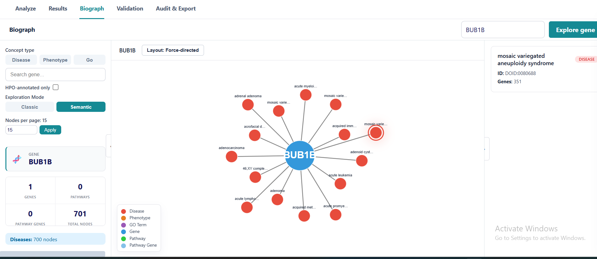
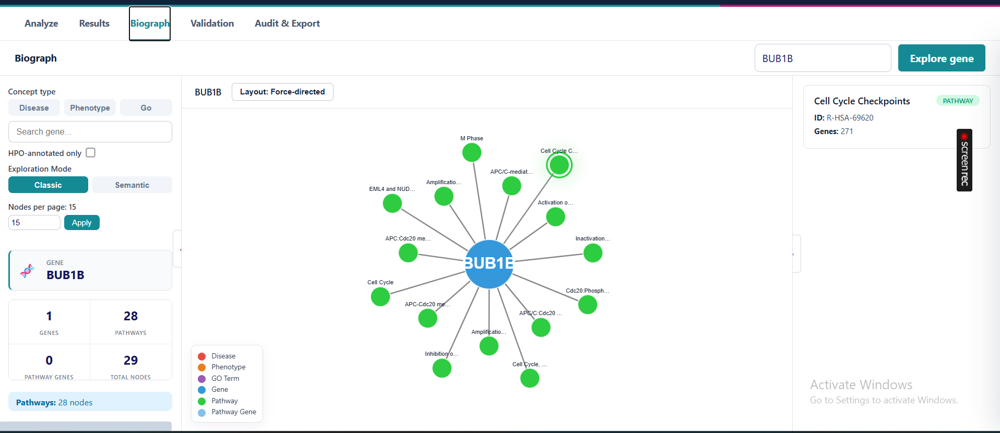
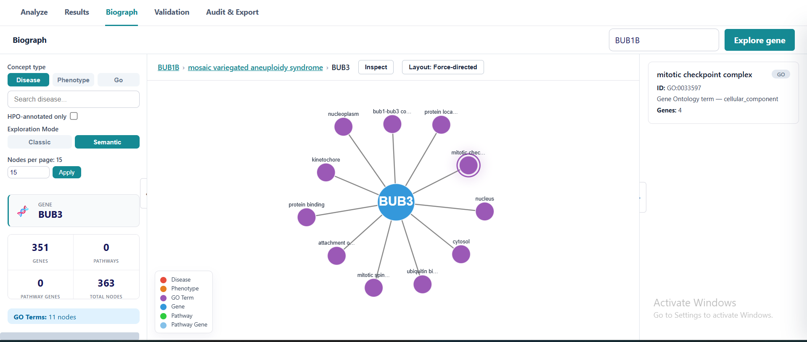

# BioGraph — interface gallery

These screenshots illustrate the separately developed BioGraph application's interactive gene–disease–pathway exploration, integrated as a post-ranking interpretation tool in MVA Explorer.

| Exploration | Screenshot |
|---|---|
| BUB1B — Semantic mode, disease associations |  |
| BUB1B — Classic mode, pathway associations |  |
| BUB3 — Semantic mode, Gene Ontology terms |  |

Screenshots are interface demonstrations, not evidence that individual relationships, ranking results, or variants have been experimentally validated.
