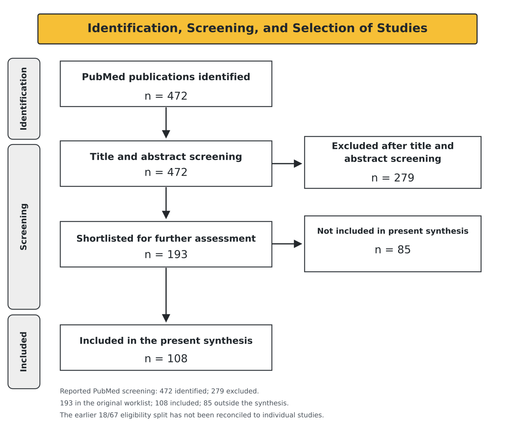
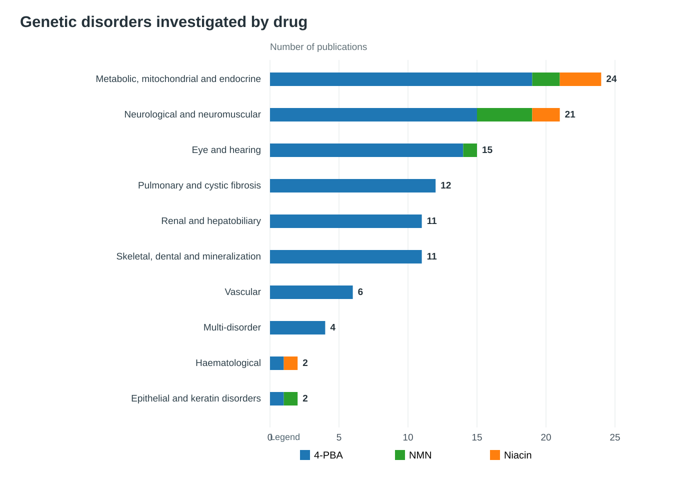
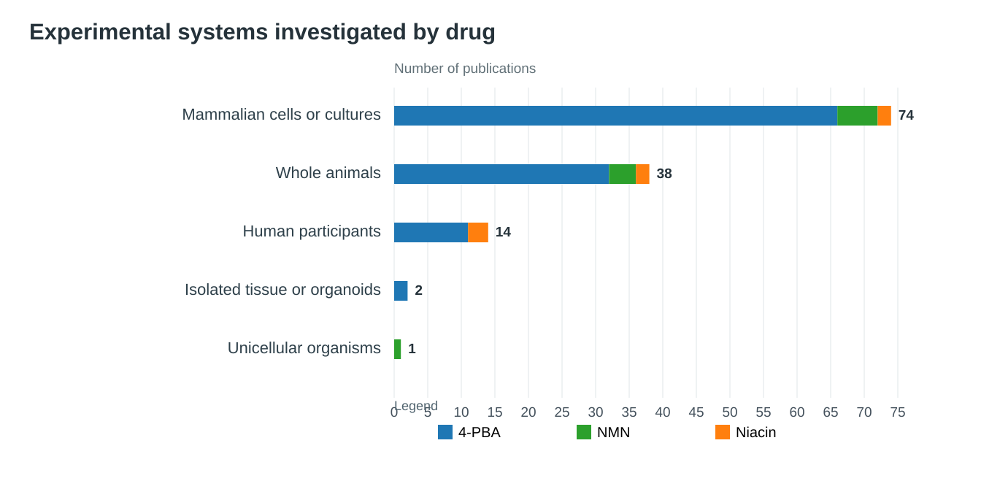
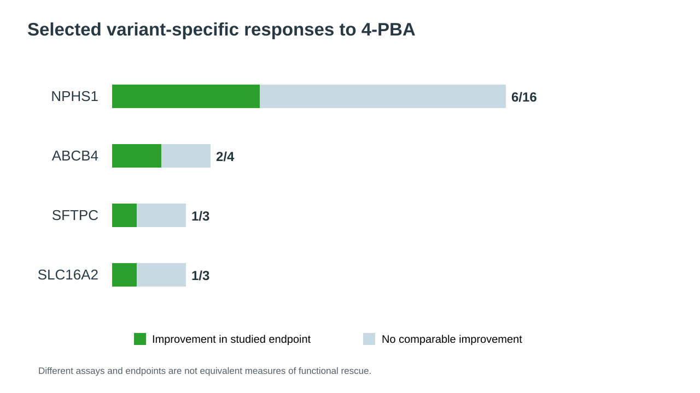

# MVA: Scoping Evidence Review

**Single-researcher preliminary scoping review · 108 publications included in the present synthesis**

## 1. Introduction

Mosaic variegated aneuploidy (MVA) syndrome is a rare genetic disorder characterised by cells with differing abnormal chromosome numbers alongside cells with a normal chromosome complement. The disorder results from impaired chromosome segregation during cell division. Pathogenic alterations in **BUB1B**, **CEP57** and **TRIP13** are recognised genetic causes; their effects on spindle-checkpoint function and the mitotic apparatus can contribute to chromosome mis-segregation. MVA is clinically heterogeneous, with developmental abnormalities and, in some forms, increased cancer predisposition. Its molecular and phenotypic consequences are not yet fully understood, and disease-specific interventional clinical evidence remains extremely limited.

For Track 2, **four pharmacological repurposing hypotheses: niacin, 4-phenylbutyrate (4-PBA), gentamicin and amlexanox**, were prioritised through a scoping review. Nicotinamide mononucleotide (NMN) was considered separately as an NAD⁺-pathway mechanistic comparator, not as a fifth Track 2 candidate. The aim of this review was to map the available evidence on these three compounds, identify the genetic disorders and alterations investigated, describe the experimental systems and treatment duration, dosage, and examine  outcomes that may inform the direction of future MVA functional studies.

**Review scope.** This is a one-person research effort, supported by AI-assisted screening and evidence organisation. The present synthesis is intentionally limited to **108 publications** for which Methods and Results were examined. The original 193-publication worklist contains **85 citations outside the current 108-publication synthesis**. These other citations are retained in the bibliography, but their record-level eligibility and assessment status have not all been reconciled; none contributes to the results reported here.

## 2. Methods

### 2.1 Information sources and study selection

The original PubMed search summary reported 472 unique publications, of which 279 were excluded during AI-assisted title and abstract screening. The resulting **193-publication worklist** is preserved in the research materials. At the MVA Hackathon submission, 14 publications had been manually reviewed; an intermediate register of 87 publications was assembled after the event.

The present synthesis includes **108 distinct publications** whose Methods and Results were examined. The other **85 citations** in the original worklist are not included in this synthesis. An earlier working summary divided these into 18 eligibility exclusions and 67 publications awaiting full-text assessment, but these two groups have **not been reconciled to individual study identifiers** and should not be presented as confirmed final eligibility categories. The figure consequently reports the verified 193-to-108 selection and labels the older 18/67 division as provisional.

*Figure 1. Identification, screening and selection of publications. The 472 and 279 figures originate from the working PubMed search summary; the 193 and 108 counts are confirmed in the underlying worklist and extraction. The 85 worklist publications outside the present synthesis have not yet been reconciled into verified eligibility categories.*

### 2.2 Evidence extraction and synthesis

The review documented genetic disorders, identified genes and variants, species, cellular and animal models, clinical study settings, and the disease-related phenotypes and endpoints investigated. Mammalian cell cultures were considered separately from whole-animal exposure studies, and human-derived cells were distinguished from interventions involving human participants. Publications using multiple systems were represented in each applicable category.

For the disease-theme overview, publications examining two or more distinct disease entities were grouped under **Multi-disorder**, rather than assigned to a single primary disease family. Reported findings were summarised according to the experimental endpoints, while uncertainties in variant and model classification were retained. This work was a targeted, single-researcher evidence map and was not an independently duplicated systematic review.

The [saved 14-study original Track 2 evidence table](../submissions/track2/results/G1_Focused_Scoping_Review_14_studies.csv) is published separately from this post-hackathon 108-publication synthesis. The [recorded search strategy](PUBMED_SEARCH_STRATEGY.md) and [Data extraction table](Data_Extraction_Table.csv) provide supplementary publication records. The 14-study file is a preserved research extraction, not an authenticated copy of a competition-portal upload.

## 3. Results

### 3.1 Genetic disorders and drug candidates investigated

Among the 108 included publications, 94 (87.0%) investigated 4-PBA, eight (7.4%) investigated NMN and six (5.6%) investigated niacin.

The publications encompassed a broad range of genetic disorders, predominantly metabolic, mitochondrial and endocrine disorders (22.2%, n=24), followed by neurological and neuromuscular disorders (19.4%, n=21). Eye and hearing disorders accounted for 15 publications (13.9%), while pulmonary disorders accounted for 12 (11.1%). Renal and hepatobiliary disorders, as well as skeletal, dental and mineralisation disorders, each accounted for 11 publications (10.2%). The remaining publications investigated vascular disorders (n=6), haematological disorders (n=2) and epithelial or keratin-associated disorders (n=2).

Four publications investigated two or more distinct genetic disorders or disease entities within the same study and were classified under Multi-disorder. Of these, three investigated two disease groups each: trisomy 13 and trisomy 21; autosomal dominant and recessive *BEST1*-associated bestrophinopathies; and sickle cell anaemia and β-thalassaemia. The remaining publication investigated four urea-cycle disorders, comprising argininosuccinate lyase (*ASL*) deficiency, argininosuccinate synthetase (*ASS1*) deficiency, ornithine transcarbamylase (*OTC*) deficiency and arginase (*ARG1*) deficiency.

4-PBA was the most frequently investigated compound across the included disease categories, followed by NMN and lastly niacin (Figure 2). Its predominance was particularly evident in pulmonary, renal and skeletal disorders, whereas NMN investigations were concentrated in neurological, neuromuscular and mitochondrial disease models. Niacin was less frequently investigated and was primarily represented in studies involving peripheral neuropathies, metabolic disorders and haematological conditions.

*Figure 2. Distribution of the 108 included publications by genetic disorder and investigated drug. Publications investigating multiple distinct disorders were classified under Multi-disorder rather than assigned to a single primary disease category.*

### 3.2 Experimental systems and species investigated

The included publications employed a range of experimental systems to investigate treatment responses. Mammalian cell cultures were the most frequently used experimental system (74/108), followed by whole-animal models (38/108). Human intervention studies accounted for 14 publications, while isolated tissue or organoid experiments and unicellular organisms were represented in two and one publication, respectively (Figure 3).

#### 3.2.1 Mammalian cell cultures

Among the 74 publications employing mammalian cell cultures, 66 investigated 4-PBA, six investigated NMN and two investigated niacin. These studies employed different cell types and experimental preparations, including established mammalian cell lines, patient-derived cells, primary cultures and induced pluripotent stem cell (iPSC)-derived models.

Among the explicitly described cell preparations, fibroblasts were represented in at least seven publications, epithelial cell cultures in seven, neuronal cultures in five and astrocytes in two. Three publications included iPSC-derived experimental systems. Additional investigations employed epidermal keratinocytes, retinal pigment epithelial cells, osteoblasts, hepatocyte-like cells, erythroid precursors and other specialised cell preparations.

Established cell lines included HEK293 cells in studies investigating creatine transporter and ABCA1 variants, COS-7 cells in studies of mutant crystallin and carbonic anhydrase IV, and MDCK cells expressing mutant uromodulin. Other models included C2C12 muscle cells, HEI-OC1 auditory cells and CHO cells. HeLa cells were also employed in a study investigating the *GJA8* Cx50 D47A variant associated with congenital cataracts.

Treatment responses differed across the investigated cellular models. Among the 55 publications using mammalian cell cultures without whole-animal or human intervention experiments, 18 reported predominantly favourable outcomes, 28 reported partial or conditional improvements, four reported no improvement or unfavourable findings, and five primarily described other experimental or comparative outcomes.

Favourable responses were frequently reported in assays measuring protein localisation, expression, trafficking or selected cellular functions. For example, 4-PBA improved cell-surface localisation of six of 16 investigated nephrin variants, while two of four specified ABCB4 variants demonstrated improvements in trafficking and phospholipid efflux. In contrast, other studies reported increased protein abundance without corresponding functional recovery. Similarly, nicotinic acid treatment did not restore the measured mitochondrial functions in MERRF-associated patient-derived fibroblasts and cybrids.

#### 3.2.2 Studies involving both mammalian cell cultures and whole-animal models

Eighteen publications employed both mammalian cell cultures and whole-animal experimental systems. Of these, 15 investigated 4-PBA, two investigated NMN and one investigated niacin. Seven publications reported predominantly favourable outcomes across their recorded endpoints, whereas 11 reported partial, mixed or conditional findings.

One investigation involving congenital cataracts examined 4-PBA in HeLa cells expressing the *GJA8* Cx50 D47A variant and in mice carrying the corresponding genetic alteration. Treatment improved mutant connexin trafficking and gap-junction plaque formation in cultured cells. In the treated mice, connexin abundance and distribution also improved; however, cataract size and density did not demonstrate detectable improvement.

A similar difference between molecular and organism-level outcomes was reported in multiple epiphyseal dysplasia associated with *MATN3* I192N. The investigations included mutant protein expression in cultured cells and treatment of mutant mice. Although modest changes in selected chaperone-associated measures were observed in the mice, mutant protein secretion and the long-term skeletal phenotype did not demonstrate corresponding recovery.

In *BMPR2* C118W-associated pulmonary arterial hypertension, 4-PBA increased SMAD1/5 phosphorylation in mutant primary cells, while partial improvement in receptor processing was observed in the corresponding mouse model. Other investigations demonstrated favourable outcomes at both molecular and organism levels. For example, studies involving *ACTN4* K256E-associated glomerular disease reported reduced endoplasmic reticulum stress and albuminuria, whereas treatment of *FGD4*-deficient mice with niacin reduced abnormal myelin outfoldings.

NMN was investigated across multiple experimental systems in Barth syndrome-associated models, including TAZ-deficient mammalian cells, Taz-mutant fruit flies and budding yeast carrying a cardiolipin-synthesis defect. Improvements were reported in selected cellular redox and mitochondrial endpoints, together with improved climbing performance in treated fruit flies.

These studies provided evidence at different experimental levels, with treatment responses ranging from improvements in both cellular and organism-level endpoints to molecular changes without corresponding phenotypic recovery.

#### 3.2.3 Whole-animal experimental models

Whole-animal models were employed in 38 publications, including 32 investigating 4-PBA, four investigating NMN and two investigating niacin. Of these, 18 also employed mammalian cell cultures, whereas 20 investigated whole animals without a separate mammalian cell-culture experiment.

Among the latter 20 publications, 11 reported predominantly favourable outcomes, eight reported partial or conditional findings, and one reported an unfavourable or null outcome.

Mice (*Mus musculus*) were the predominant whole-animal species, represented in 32 publications. Other animal models included zebrafish (*Danio rerio*), fruit flies (*Drosophila*) and nematodes (*Caenorhabditis elegans*).

Whole-animal investigations assessed a broader range of phenotypes than cellular experiments, including survival, locomotor activity, bone growth and fragility, neurological function, renal abnormalities, mitochondrial function and tissue pathology. For example, 4-PBA reduced albuminuria in an *ACTN4* K256E mouse model and improved selected skeletal measures in osteogenesis imperfecta models. However, in *Col1a2* G610C mice, improved longitudinal bone growth was not accompanied by correction of bone fragility.

#### 3.2.4 Human intervention studies

Human intervention studies accounted for 14 of the 108 publications, comprising 11 investigating 4-PBA and three investigating niacin. No NMN human intervention studies were represented in the included publications.

The human investigations primarily assessed metabolic control, clinical symptoms, pharmacokinetics and treatment-associated biochemical changes. Seven publications focused predominantly on pharmacokinetics, comparative formulations or related treatment evaluations, while six reported mixed or conditional outcomes. One publication reported predominantly favourable outcomes in an uncontrolled clinical cohort.

Among the 4-PBA investigations, three patients with *ATP8B1*-associated progressive familial intrahepatic cholestasis type 1 demonstrated improvements in pruritus following treatment, without corresponding improvements in liver biochemical or histological findings. In maple syrup urine disease, reductions in plasma leucine and branched-chain ketoacids were reported in selected patients, although treatment responses varied between individuals.

An investigation involving ten children with spinal muscular atrophy type II reported improvements in motor-function scores following sodium phenylbutyrate treatment. However, the study did not include a concurrent control group. Other 4-PBA investigations, particularly those involving urea-cycle disorders, primarily evaluated ammonia control, drug exposure and comparisons between phenylbutyrate formulations.

Among the three niacin intervention studies, outcomes were predominantly mixed or conditional. In a randomised study involving 27 adults with sickle cell disease, niacin treatment improved selected lipid ratios, but the difference in HDL cholesterol did not reach statistical significance and none of the three endothelial-function assessments demonstrated improvement. Similarly, an investigation involving 19 men with low HDL cholesterol reported a 22% increase in HDL cholesterol without corresponding improvements in cholesterol-efflux biomarkers. A third investigation involving familial hypercholesterolaemia reported improvements in selected lipid measures, with HDL responses differing between clinical subgroups.

Compared with the cell-culture and whole-animal investigations, the human intervention publications provided fewer reports of improvements across all investigated disease-relevant endpoints. The reported benefits were more frequently confined to selected symptoms, metabolic measurements or biochemical markers, while other endpoints remained unchanged.

#### 3.2.5 Species represented across the included publications

*Homo sapiens* (humans) was the most frequently represented species overall, occurring in 63 publications, followed by *Mus musculus* (mice) in 42 publications. Human-derived biological material was predominantly used in 4-PBA investigations (n=57), whereas mice were represented in all eight NMN publications, including experiments using mouse-derived cell cultures.

Human-derived experimental material was therefore more frequently represented than direct human intervention studies. Of the 63 publications involving *Homo sapiens*, only 14 administered the investigated drug to human participants. The remaining publications primarily employed human-derived cultured cells or isolated biological material.

Among non-mammalian organisms, fruit flies and nematodes were investigated as multicellular animal models. Budding yeast (*Saccharomyces cerevisiae*) was represented in one NMN-associated investigation involving mitochondrial and cardiolipin-related abnormalities.

*Figure 3. Experimental systems employed across the included publications by drug candidate. Publications involving multiple systems contribute to the corresponding experimental-system categories.*

### 3.3 Drug concentrations, administration and treatment durations

Drug concentrations, administered doses and treatment durations varied considerably across the included publications and experimental systems.

Mammalian cell-culture investigations commonly employed concentrations in the millimolar range over treatment periods of 24–96 hours. Among the selected 4-PBA investigations, concentrations included 1 mM for ABCB4-associated transporter experiments, 4 mM for MCT8-associated thyroid hormone transport and 10 mM for nephrin-associated protein trafficking. NMN concentrations included 100 µM in PRPS1-depleted auditory cells and 5 mM in mutant SOD1 astrocytes, while nicotinic acid was investigated at concentrations including 5 mM in myelination co-cultures and 10 mM in mitochondrial disease models.

Whole-animal investigations employed a broader range of treatment durations, extending from several days to weeks or months. Treatment regimens varied according to the investigated species, administration route and disease model. In *SLC6A1* mutant mice, 4-PBA was administered at 100 mg/kg/day over seven or 28 days using different routes. NMN was investigated at 900 mg/kg/day over two weeks in PolgA mutator mice, whereas niacin was administered at 60 mg/kg/day over eight weeks in an *FGD4*-deficient mouse model.

Human intervention studies primarily employed oral treatment regimens. These included 12–18 g/day sodium phenylbutyrate over four weeks in Huntington disease, escalating 4-PBA doses over six months in progressive familial intrahepatic cholestasis type 1, and niacin titrated to 1.5 g/day over 12 weeks in sickle cell disease.

Selected experimental treatment conditions are presented in Table 1.

| Experimental model | Drug | Reported dose | Treatment duration |
|---|---|---|---|
| *NPHS1* mutant cells | 4-PBA | 10 mM | 24 hours |
| *ABCB4* mutant cells | 4-PBA | 1 mM | 24 hours |
| *SLC16A2* mutant cells | 4-PBA | 4 mM | 48 hours |
| SOD1-mutant astrocytes | NMN | 5 mM | 24 hours |
| MERRF-associated cells | Niacin | 10 mM | 96 hours |
| *SLC6A1* mutant mice | 4-PBA | 100 mg/kg/day | 7 or 28 days |
| PolgA mutator mice | NMN | 900 mg/kg/day | 2 weeks |
| *FGD4*-deficient mice | Niacin | 60 mg/kg/day | 8 weeks |
| Huntington disease participants | 4-PBA | 12–18 g/day | 4 weeks |
| Sickle cell disease participants | Niacin | Up to 1.5 g/day | 12 weeks |

*Table 1. Selected experimental concentrations, administered doses and treatment durations reported in the included publications. The complete study-by-study treatment regimens are provided in the accompanying Excel evidence-extraction sheet (Supplementary Table S1).*

### 3.4 Reported outcomes of the investigated drug candidates

#### 3.4.1 4-Phenylbutyrate (4-PBA)

4-Phenylbutyrate is an aromatic fatty-acid derivative with several established pharmacological activities, including its role in alternative nitrogen disposal. It has also been investigated for chemical chaperone activity, modulation of endoplasmic reticulum stress and histone deacetylase inhibition. Among the 94 included publications, 4-PBA was most frequently investigated for its effects on mutant protein folding, intracellular trafficking, secretion and functional recovery.

Several investigations reported varying treatment responses across genetic variants. In congenital nephrotic syndrome, treatment of cells expressing 16 *NPHS1* missense variants with 10 mM 4-PBA for 24 hours improved cell-surface expression in six variants (W64S, S350P, S366R, R367C, R802W and R831C), whereas the remaining ten variants did not demonstrate comparable recovery.

Similar variant-dependent responses were observed in *ABCB4*-associated cholestasis. Following treatment with 1 mM 4-PBA for 24 hours, the G228R and A934T variants demonstrated improved trafficking and phospholipid efflux, whereas G68R and D459H did not demonstrate corresponding recovery of cell-surface localisation.

Differences were also reported in studies investigating *SLC16A2*, which encodes the thyroid hormone transporter MCT8. Treatment improved triiodothyronine (T3) uptake in cells expressing the ΔPhe501 variant, whereas the L471P variant demonstrated increased protein expression without corresponding recovery of transport activity. Similarly, increased cell-surface abundance of R445L did not restore T3 transport.

In surfactant protein C-associated interstitial lung disease, 4-PBA improved the maturation and processing of the *SFTPC* L188Q variant, whereas I73T and Δexon4 did not demonstrate equivalent improvement. Increased proprotein aggregation was also observed in the investigated models.

Further variation was reported in studies investigating pyruvate dehydrogenase complex deficiency. Among 12 *PDHA1*-deficient cell lines, eight demonstrated increased enzyme activity following treatment, whereas one of two *PDHX*-deficient lines showed a comparable response.

Treatment responses also differed between cellular and whole-animal investigations. In cultured cells expressing *UMOD* C126R and C217G, 4-PBA improved intracellular trafficking and secretion of mutant uromodulin. However, a separate investigation involving *Umod* mutant mice did not demonstrate recovery of protein maturation, while plasma urea concentrations worsened in the C93F model.

Other whole-animal investigations reported improvements in selected disease-associated phenotypes. In an *ACTN4* K256E mouse model, 4-PBA reduced albuminuria and endoplasmic reticulum stress. Similarly, treatment of osteogenesis imperfecta models was associated with improvements in selected skeletal measurements, including bone growth and cortical thickness. However, the outcomes varied across the investigated variants and bone-related endpoints.

In *SLC6A1* S295L mutant mice, treatment-associated improvements in locomotor outcomes were observed following a longer oral treatment regimen, whereas the shorter intraperitoneal regimen did not produce equivalent improvement.

Human investigations reported additional outcomes involving metabolic control and clinical symptoms. In three patients with *ATP8B1*-associated progressive familial intrahepatic cholestasis type 1, treatment was associated with reduced pruritus without corresponding improvements in liver biochemical or histological measurements. Among patients with maple syrup urine disease, reductions in selected branched-chain amino acids and ketoacids were observed, with treatment responses varying between patients.

In Huntington disease, sodium phenylbutyrate treatment was associated with changes in selected molecular biomarkers. Other investigations involving urea-cycle disorders primarily assessed ammonia control, pharmacokinetics and differences between phenylbutyrate formulations.

Overall, 4-PBA investigations reported improvements in several molecular, cellular and organism-level outcomes, although responses varied across genetic alterations, experimental systems and disease-associated phenotypes.

#### 3.4.2 Nicotinamide mononucleotide (NMN)

Nicotinamide mononucleotide is an intermediate in nicotinamide adenine dinucleotide (NAD⁺) biosynthesis. Among the included publications, NMN was investigated primarily for its effects on NAD⁺ availability, mitochondrial function, cellular redox regulation and stress-associated pathways.

Eight publications investigated NMN across genetic disorders, predominantly involving mammalian cell cultures and whole-animal models.

In amyotrophic lateral sclerosis-associated models, NMN treatment increased NAD⁺ abundance in mutant SOD1 astrocytes and reduced their vulnerability to oxidative stress. Related co-culture investigations reported reduced astrocyte-mediated toxicity to motor neurons. Additional experiments involving SOD1 G93A motor neurons demonstrated improved survival following trophic-factor withdrawal, whereas comparable improvement was not observed under all trophic-factor conditions.

NMN was also investigated in Barth syndrome-associated mitochondrial models. Experiments involving TAZ-deficient mammalian cells, mutant fruit flies and budding yeast demonstrated improvements in selected cellular redox and mitochondrial membrane-polarisation measurements, together with improved climbing performance in treated fruit flies.

In *KRT18* R90C-associated cellular injury, NMN reduced filament aggregation and apoptosis, accompanied by changes in keratin acetylation. Similarly, in *PRPS1*-depleted auditory cells, treatment partially improved mitochondrial abnormalities and reduced cellular injury.

Whole-animal investigations reported additional outcomes involving mitochondrial function and reproductive phenotypes. In PolgA mutator mice, NMN improved fertility and selected oocyte-associated redox measurements, although not all mitochondrial endpoints were restored.

In frataxin-knockdown mice, NMN treatment was associated with prolonged survival in males, while cardiac outcomes varied according to sex.

Collectively, NMN investigations reported improvements in several cellular and organism-level outcomes, predominantly involving oxidative stress, mitochondrial abnormalities, cell survival and selected disease-associated phenotypes. However, the magnitude and direction of these responses differed across the investigated genetic models and experimental endpoints.

#### 3.4.3 Niacin

Niacin, investigated as nicotinic acid in the included publications, is a form of vitamin B3 involved in NAD-related metabolism and lipid regulation. Six publications investigated niacin in genetic disorders, primarily involving peripheral neuropathies, mitochondrial dysfunction and inherited metabolic or haematological conditions.

Among the whole-animal investigations, favourable outcomes were reported in experimental peripheral neuropathy. In an *FGD4*/FRABIN-deficient mouse model of Charcot–Marie–Tooth disease type 4H, treatment with niacin over eight weeks reduced abnormal myelin outfoldings. The study included five treated and four saline-treated mice in the reported comparison.

A separate investigation involving *Mtmr2*-null mice also reported reduced myelin outfoldings following niacin treatment, accompanied by changes in TACE-associated signalling.

In contrast, less favourable outcomes were observed in mitochondrial disease models. In MERRF-associated cybrids and patient-derived fibroblasts carrying the mitochondrial m.8344A>G alteration, treatment with nicotinic acid failed to restore the measured mitochondrial functions under the investigated conditions.

Human intervention studies primarily assessed lipid metabolism and related clinical biomarkers. In a randomised study involving 27 adults with sickle cell disease, 12 weeks of extended-release niacin improved selected lipid ratios. However, the difference in HDL cholesterol did not reach statistical significance, and none of the three investigated endothelial-function endpoints demonstrated improvement.

Similarly, an investigation involving 19 men with low HDL cholesterol reported a 22% increase in HDL cholesterol following treatment, without corresponding improvements in cholesterol-efflux biomarkers. Although four participants carried *ABCA1* variants, a separate treatment response for these individuals was not established.

Another investigation involving familial hypercholesterolaemia reported reductions in triglycerides and VLDL cholesterol, while HDL responses differed between the investigated clinical subgroups.

Overall, niacin demonstrated favourable outcomes in selected peripheral neuropathy models and improvements in some human metabolic measurements. However, these improvements were not consistently accompanied by recovery of mitochondrial, vascular or other disease-associated functional endpoints.

### 3.5 Variation in treatment responses across genetic alterations

Treatment responses differed across the investigated genetic alterations, particularly in studies assessing multiple variants of the same gene.

Among the *NPHS1* missense variants investigated, six of 16 demonstrated improved cell-surface localisation following 4-PBA treatment, while ten did not demonstrate comparable improvement. Similarly, two of four specified *ABCB4* variants demonstrated improvements in trafficking and phospholipid efflux.

In *SLC16A2*-associated thyroid hormone transport deficiency, functional recovery was reported for ΔPhe501, whereas L471P and R445L did not demonstrate corresponding recovery of T3 transport despite improvements in selected protein-expression or localisation measurements.

Similar differences were evident in *SFTPC*-associated interstitial lung disease, where improved maturation was reported for L188Q but not equivalently for I73T or Δexon4.

In pyruvate dehydrogenase complex deficiency, enzyme activity improved in eight of 12 *PDHA1*-deficient cell lines and one of two *PDHX*-deficient cell lines following 4-PBA treatment.

The investigated genetic models also included experimentally induced gene knockouts and knockdowns. These were particularly represented in NMN and niacin investigations, where treatment-associated improvements frequently involved downstream cellular or organism-level phenotypes. For example, NMN partially improved mitochondrial abnormalities in *PRPS1*-depleted cells, whereas niacin reduced abnormal myelin outfoldings in *FGD4*-deficient and *Mtmr2*-null mouse models.

Across the included publications, improvements in mutant protein abundance, trafficking or localisation were not consistently accompanied by corresponding changes in functional activity. In other investigations, improvements were observed at the tissue or organism level despite the underlying genetic defect remaining present.

The observed outcomes therefore varied according to the investigated genetic alteration, experimental model and measured phenotype (Figure 4).

*Figure 4. Selected variant-specific responses to 4-PBA across NPHS1, ABCB4, SFTPC and SLC16A2 investigations. The reported improvements correspond to the specific molecular or functional endpoints measured in the individual studies.*

### 3.6 Overall synthesis of treatment responses and implications for MVA research

The present scoping review identified several differences in the mechanisms, experimental models and treatment responses reported for 4-PBA, NMN and niacin. Across the 108 included publications, 4-PBA was the most frequently investigated compound, accounting for 87.0% of the studies. This predominance reflects a more extensive published experimental evidence base for 4-PBA within the reviewed literature, although the greater number of investigations does not necessarily establish superior therapeutic efficacy.

A recurring finding across the 4-PBA studies was the influence of individual genetic alterations on treatment responsiveness. For example, improvements in nephrin trafficking were observed in six of 16 investigated *NPHS1* variants, whereas only two of four *ABCB4* variants demonstrated recovery of the measured trafficking and functional endpoints. Similar differences were observed in *SLC16A2* and *SFTPC*, where some variants demonstrated improved protein processing or transport activity while others remained functionally impaired.

These findings suggest that the molecular consequences of individual genetic alterations may influence treatment responsiveness. In particular, variants associated with protein misfolding, intracellular retention or impaired maturation may retain different capacities for functional recovery. However, the underlying mechanisms responsible for responsiveness were not established in every investigation.

Furthermore, the evidence demonstrated differences between improvements measured in cell cultures and those observed in whole-animal models. In *GJA8* Cx50 D47A-associated cataracts, 4-PBA improved mutant connexin trafficking and distribution, but cataract severity did not improve detectably in treated mice. Similarly, in *MATN3*-associated skeletal disease, changes in selected molecular measurements were not accompanied by sustained recovery of the skeletal phenotype.

These contrasting outcomes may reflect differences in the biological processes required to restore a cellular function compared with those required to improve an established tissue or organism-level phenotype. They may also be influenced by treatment exposure, duration, disease progression and the specific molecular consequences of the investigated variants. However, the relative contribution of these factors could not be determined consistently across the included studies.

NMN demonstrated a different pattern of treatment responses, predominantly involving NAD⁺ metabolism, mitochondrial function and oxidative stress. Improvements were reported in mutant SOD1-associated cellular models, mitochondrial disease models and selected whole-animal investigations. However, several NMN investigations involved experimentally induced gene depletion or transgenic models, where treatment primarily modified downstream cellular abnormalities rather than directly restoring the function of an altered gene product.

Niacin investigations demonstrated favourable outcomes in selected peripheral neuropathy models, particularly those involving abnormalities in peripheral nerve myelination. Nevertheless, contrasting findings were observed in mitochondrial disease models, where treatment did not restore the measured mitochondrial functions. Human intervention studies also reported improvements in some biochemical measurements without corresponding changes in selected functional or clinical endpoints.

The differences between experimental systems were particularly evident when comparing the cellular, animal and human intervention studies. Cell cultures frequently demonstrated favourable or partially favourable molecular responses, whereas whole-animal investigations assessed additional phenotypes involving tissue pathology, behaviour, survival and organ function. Among the 14 human intervention publications, seven primarily involved pharmacokinetic or treatment-comparison investigations, six reported mixed or conditional outcomes, and one reported favourable motor-score changes in an uncontrolled clinical cohort.

Consequently, the available human evidence was less informative regarding direct variant-specific functional rescue than the cellular investigations. This was particularly evident in studies reporting changes in lipid metabolism, ammonia control or clinical symptoms without directly demonstrating recovery of the molecular function affected by the underlying genetic alteration.

With respect to mosaic variegated aneuploidy (MVA), these findings provide several potential directions for future experimental investigation. BUB1B-associated MVA involves impairment of the spindle-assembly checkpoint, and the reviewed literature did not establish that 4-PBA, NMN or niacin restores BUB1B-associated checkpoint dysfunction.

However, the findings provide experimental precedents for investigating whether modulation of protein homeostasis, mitochondrial metabolism and cellular stress responses could influence downstream abnormalities associated with BUB1B dysfunction.

Among the three compounds, 4-PBA offers the broadest published experimental evidence within this review, including multiple investigations of variant-dependent protein processing and functional recovery. NMN and niacin provide additional evidence involving NAD-related metabolism, mitochondrial abnormalities and selected tissue-associated phenotypes.

Overall, the findings highlight the importance of investigating treatment responses according to the underlying genetic alteration, the biological mechanism targeted and the functional endpoint measured. Future MVA-directed investigations would therefore need to establish whether the selected compounds influence BUBR1 protein abundance or stability, spindle-assembly checkpoint activity, chromosome segregation fidelity and associated cellular phenotypes before any therapeutic implications could be considered.

### Supplementary Table S1. Experimental models across 108 publications

**Supplementary Table S1 is embedded directly below.** Swipe horizontally within the table to view studies 11–20, 21–30 and the remaining groups of ten; the page continues vertically after the table. Each included publication appears once, with its genetic model, investigated compound, species and experimental system.

| **Studies 1–10: gene/model** | **Compound** | **Species** | **System** | **Studies 11–20: gene/model** | **Compound** | **Species** | **System** | **Studies 21–30: gene/model** | **Compound** | **Species** | **System** | **Studies 31–40: gene/model** | **Compound** | **Species** | **System** | **Studies 41–50: gene/model** | **Compound** | **Species** | **System** | **Studies 51–60: gene/model** | **Compound** | **Species** | **System** | **Studies 61–70: gene/model** | **Compound** | **Species** | **System** | **Studies 71–80: gene/model** | **Compound** | **Species** | **System** | **Studies 81–90: gene/model** | **Compound** | **Species** | **System** | **Studies 91–100: gene/model** | **Compound** | **Species** | **System** | **Studies 101–108: gene/model** | **Compound** | **Species** | **System** |
| --- | --- | --- | --- | --- | --- | --- | --- | --- | --- | --- | --- | --- | --- | --- | --- | --- | --- | --- | --- | --- | --- | --- | --- | --- | --- | --- | --- | --- | --- | --- | --- | --- | --- | --- | --- | --- | --- | --- | --- | --- | --- | --- | --- |
| **1.** SLC6A1 S295L; SLC6A1 S295L heterozygous mice | 4-PBA | Mouse; (Mus musculus) | Mouse · Whole animals | **11.** ABCB4 G68R, G228R, D459H and A934T; Cells expressing ABCB4 variants | 4-PBA | Dog; (Canis lupus familiaris); Human; (Homo sapiens) | Human · Mammalian cells or cultures; Dog · Mammalian cells or cultures | **21.** ABCA1 variants including R1068H and N1800H; ABCA1 variant-expressing HEK293 cells and patient fibroblasts | 4-PBA | Human; (Homo sapiens) | Human · Mammalian cells or cultures | **31.** Disease-associated type I collagen variants; Osteogenesis imperfecta patient fibroblasts | 4-PBA | Human; (Homo sapiens) | Human · Mammalian cells or cultures | **41.** HBB-associated sickle cell anemia; the trial reports cohort-level effects; 27 adults with sickle cell disease randomized to… | Niacin | Human; (Homo sapiens) | Human · Human participants | **51.** Rasa1 conditional deletion and RASA1 siRNA; RASA1-deficient vascular model | 4-PBA | Human; (Homo sapiens); Mouse; (Mus musculus) | Mouse · Whole animals; Human · Mammalian cells or cultures | **61.** SOD1 A4V and G41D barrel constructs; Engineered ER-targeted SOD1 A4V barrel model | 4-PBA | Human; (Homo sapiens) | Human · Mammalian cells or cultures | **71.** KRT18 R90C; SIRT2 pathway; Cells expressing mutant K18 | NMN | Human; (Homo sapiens); Mouse; (Mus musculus) | Mouse · Whole animals; Human · Mammalian cells or cultures | **81.** Sms mutant flies; SAT1-related mechanistic assays; Drosophila Sms mutant model of Snyder–Robinson syndrome | 4-PBA | Fruit fly; (Drosophila); Human; (Homo sapiens) | Fruit fly · Whole animals; Human · Mammalian cells or cultures | **91.** Col4a1+/Δex41; Col4a1 mutant mice | 4-PBA | Mouse; (Mus musculus) | Mouse · Whole animals | **101.** ASL, ASS1, OTC and ARG1 deficiency groups; Children with urea cycle disorders | 4-PBA | Human; (Homo sapiens) | Human · Human participants |
| **2.** SLC6A8 R391W, P544L and other tested variants; SLC6A8 variant-expressing HEK293 cells and rat neurons | 4-PBA | Human; (Homo sapiens); Rat; (Rattus norvegicus) | Human · Mammalian cells or cultures; Rat · Mammalian cells or cultures | **12.** STXBP1/Munc18-1 disease variants; Munc18-1 disease variants in cellular and worm models | 4-PBA | C. elegans; (Caenorhabditis elegans); Human; (Homo sapiens); Mouse; (Mus musculus) | C. elegans · Whole animals; Human · Mammalian cells or cultures; Mouse · Mammalian cells or cultures | **22.** Actn4 K256E mouse; human counterpart K255E; Mutant alpha-actinin-4 glomerular disease mice | 4-PBA | Mouse; (Mus musculus) | Mouse · Whole animals; Mouse · Mammalian cells or cultures | **32.** TOR1A mutant torsinA; Mutant torsinA cell model | 4-PBA | Human; (Homo sapiens) | Human · Mammalian cells or cultures | **42.** Human SOD1 G93A in astrocyte models; Astrocyte cultures in an ALS study using mutant SOD1 models | NMN | Mouse; (Mus musculus) | Mouse · Mammalian cells or cultures | **52.** BMPR2 C118W; BMPR2 C118W primary cells and knock-in mouse model | 4-PBA | Human; (Homo sapiens); Mouse; (Mus musculus) | Mouse · Whole animals; Human · Mammalian cells or cultures | **62.** SLC25A1-associated combined D,L-2HGA; Patient fibroblasts from combined D,L-2-hydroxyglutaric aciduria | 4-PBA | Human; (Homo sapiens) | Human · Mammalian cells or cultures | **72.** SOD1 G93A and TDP-43 overexpression; Motor neurons from two ALS mouse models and human iPSC-derived neurons | NMN | Human; (Homo sapiens); Mouse; (Mus musculus) | Human · Mammalian cells or cultures; Mouse · Mammalian cells or cultures | **82.** CFTR F508del in IB3-1 cells; IB3-1 cells expressing F508del CFTR | 4-PBA | Human; (Homo sapiens) | Human · Mammalian cells or cultures | **92.** ABCB11 deficiency; Patient-specific hepatocyte-like cells with bile salt export pump deficiency | 4-PBA | Human; (Homo sapiens) | Human · Mammalian cells or cultures | **102.** Confirmed UCD cohort; genotype varies; Patients with urea cycle disorders | 4-PBA | Human; (Homo sapiens) | Human · Human participants |
| **3.** TAFAZZIN/TAZ; yeast crd1 deletion; fly Taz889; crd1Δ yeast, TAZ-knockout C2C12 cells and Taz889 flies | NMN | Budding yeast; (Saccharomyces cerevisiae); Fruit fly; (Drosophila); Mouse; (Mus musculus) | Fruit fly · Whole animals; Budding yeast · Unicellular organisms; Mouse · Mammalian cells or cultures | **13.** Trisomy 21 and trisomy 13 cell models; Neurons differentiated from trisomic patient iPSCs | 4-PBA | Human; (Homo sapiens) | Human · Mammalian cells or cultures | **23.** SLC16A2 variants including R445L and ΔPhe501; Patient-derived fibroblasts and MCT8 variant expression models | 4-PBA | African green monkey; (Chlorocebus (COS lineage)); Human; (Homo sapiens) | Human · Mammalian cells or cultures; African green monkey · Mammalian cells or cultures | **33.** Cdh23 erl/erl; Cdh23 erl mutant mice | 4-PBA | Mouse; (Mus musculus) | Mouse · Whole animals | **43.** PDHA1 and PDHX variants; PDHC-deficient patient fibroblasts | 4-PBA | Human; (Homo sapiens); Mouse; (Mus musculus); Zebrafish; (Danio rerio) | Mouse · Whole animals; Zebrafish · Whole animals; Human · Mammalian cells or cultures | **53.** Col1a1 Aga2/+; Col1a1 Aga2 heterozygous mice | 4-PBA | Mouse; (Mus musculus) | Mouse · Whole animals; Mouse · Mammalian cells or cultures | **63.** MYOC Y437H; MYOC Y437H transgenic glaucoma mice | 4-PBA | Mouse; (Mus musculus) | Mouse · Whole animals | **73.** ATP1A3 L924P; Cells expressing ATP1A3 L924P | 4-PBA | Human; (Homo sapiens) | Human · Mammalian cells or cultures | **83.** mtDNA m.8344A>G; MERRF mutant cybrids and patient fibroblasts | Niacin | Human; (Homo sapiens) | Human · Mammalian cells or cultures | **93.** CFTR F508del; Cells overexpressing ΔF508 CFTR | 4-PBA | Human; (Homo sapiens) | Human · Mammalian cells or cultures | **103.** HBB-related disease donor groups; Erythroid precursors from healthy donors and patients with sickle cell anaemia or beta-thalassaemia | 4-PBA | Human; (Homo sapiens) | Human · Mammalian cells or cultures |
| **4.** PRPS1 knockdown in treated auditory cells; PRPS1-knockdown HEI-OC1 auditory cells | NMN | Mouse; (Mus musculus) | Mouse · Mammalian cells or cultures | **14.** Mtmr2-null and Vim-null models; Mouse models of focal hypermyelination | Niacin | Mouse; (Mus musculus) | Mouse · Whole animals | **24.** Preproparathyroid hormone C18R; Cells expressing C18R preproparathyroid hormone | 4-PBA | Human; (Homo sapiens) | Human · Mammalian cells or cultures | **34.** BEST1 missense variants; Cells expressing dominant or recessive BEST1 variants | 4-PBA | Dog; (Canis lupus familiaris); Human; (Homo sapiens) | Human · Mammalian cells or cultures; Dog · Mammalian cells or cultures | **44.** ATP8B1-related PFIC1; Three patients with progressive familial intrahepatic cholestasis type 1 | 4-PBA | Human; (Homo sapiens) | Human · Human participants | **54.** Zebrafish furinb s741; furinb mutant zebrafish | 4-PBA | Zebrafish; (Danio rerio) | Zebrafish · Whole animals | **64.** KATP channel defect; patient subgroups examined; Primary beta cells from patients with congenital hyperinsulinism | 4-PBA | Human; (Homo sapiens) | Human · Mammalian cells or cultures | **74.** CFTR F508del/W1282X; IB3-1 human airway epithelial cells | 4-PBA | Human; (Homo sapiens) | Human · Mammalian cells or cultures | **84.** Amelogenin p.Tyr64His mouse model; Amelogenesis imperfecta mutant mice | 4-PBA | African green monkey; (Chlorocebus (COS lineage)); Mouse; (Mus musculus) | Mouse · Whole animals; African green monkey · Mammalian cells or cultures | **94.** RHO P23H; Rhodopsin P23H knock-in retinal disease model | 4-PBA | Mouse; (Mus musculus) | Mouse · Whole animals; Mouse · Mammalian cells or cultures | **104.** Col4a1/Col4a2 mouse variants; Primary cells from Col4a1/Col4a2 mutant mice | 4-PBA | Mouse; (Mus musculus) | Mouse · Mammalian cells or cultures |
| **5.** FGD4/FRABIN deficiency; CMT4H mice | Niacin | Mouse; (Mus musculus) | Mouse · Whole animals; Mouse · Mammalian cells or cultures | **15.** ABCC6 R1138Q and R1314W; ABCC6 mutants expressed in cultured cells and mouse liver | 4-PBA | Dog; (Canis lupus familiaris); Mouse; (Mus musculus) | Mouse · Whole animals; Dog · Mammalian cells or cultures | **25.** RPE65 missense variants; Disease-associated RPE65 missense proteins | 4-PBA | Human; (Homo sapiens) | Human · Mammalian cells or cultures | **35.** CA4 R14W; COS-7 cells expressing R14W carbonic anhydrase IV | 4-PBA | African green monkey; (Chlorocebus (COS lineage)) | African green monkey · Mammalian cells or cultures | **45.** Secretion-defective FGB/FGG variants; Cells expressing mutant fibrinogen | 4-PBA | African green monkey; (Chlorocebus (COS lineage)) | African green monkey · Mammalian cells or cultures | **55.** BCKD complex deficiency including E2-mutant patients; Patients with maple syrup urine disease | 4-PBA | Human; (Homo sapiens) | Human · Human participants; Human · Mammalian cells or cultures | **65.** Bmpr2 ΔEx2/+; Pulmonary endothelial cells from Bmpr2 ΔEx2 heterozygous mice | 4-PBA | Mouse; (Mus musculus) | Mouse · Mammalian cells or cultures | **75.** CFTR F508del/W1282X; IB3-1 cells with F508del/W1282X CFTR | 4-PBA | Human; (Homo sapiens) | Human · Mammalian cells or cultures | **85.** SFTPC Δexon4 and L188Q; Cells expressing SP-C Δexon4 | 4-PBA | Human; (Homo sapiens) | Human · Mammalian cells or cultures | **95.** Human SNCA Y39C transgene; Neuronal cell models and mice in a Parkinson disease study | 4-PBA | Mouse; (Mus musculus); Rat; (Rattus norvegicus) | Mouse · Whole animals; Rat · Mammalian cells or cultures | **105.** Human Tau35 fragment transgene; Transgenic mice expressing a human tau fragment | 4-PBA | Mouse; (Mus musculus) | Mouse · Whole animals |
| **6.** RPE65 variants including L22P; Cells expressing disease-associated RPE65 missense variants | 4-PBA | Human; (Homo sapiens) | Human · Mammalian cells or cultures | **16.** GJA8/Cx50 D47A; Cx50 D47A mouse lenses | 4-PBA | Human; (Homo sapiens); Mouse; (Mus musculus) | Mouse · Whole animals; Human · Mammalian cells or cultures | **26.** Epm2b deficiency; Lafora disease mouse model | 4-PBA | Mouse; (Mus musculus) | Mouse · Whole animals | **36.** Umod C93F and A227T models; Umod mutant mouse models | 4-PBA | Mouse; (Mus musculus) | Mouse · Whole animals | **46.** KRT5 E475G (EB11) and V186L (EB21); Epidermolysis bullosa simplex keratinocytes | 4-PBA | Human; (Homo sapiens) | Human · Mammalian cells or cultures | **56.** wfs1b-null; wfs1b-null zebrafish larvae | 4-PBA | Zebrafish; (Danio rerio) | Zebrafish · Whole animals | **66.** Col1a2 G610C; G610C osteogenesis imperfecta mice | 4-PBA | Mouse; (Mus musculus) | Mouse · Whole animals; Mouse · Mammalian cells or cultures | **76.** RPE65 R91W knock-in; R91W RPE65 mutant mice | 4-PBA | Mouse; (Mus musculus) | Mouse · Whole animals | **86.** HTT N171-82Q transgene; N171-82Q Huntington disease mice | 4-PBA | Mouse; (Mus musculus) | Mouse · Whole animals | **96.** HTT-associated Huntington disease; Participants with Huntington disease exposed to sodium phenylbutyrate | 4-PBA | Human; (Homo sapiens) | Human · Human participants | **106.** MATN3 I192N domain in cells; separate mutant mice; MATN3 I192N domain in CHO cells; separate mutant mouse arm | 4-PBA | Chinese hamster; (Cricetulus griseus); Mouse; (Mus musculus) | Mouse · Whole animals; Chinese hamster · Mammalian cells or cultures |
| **7.** NOTCH3-associated CADASIL; R169C in mouse arm; Patient-derived CADASIL vascular smooth muscle cells | 4-PBA | Human; (Homo sapiens); Mouse; (Mus musculus) | Mouse · Isolated tissue or organoids; Human · Mammalian cells or cultures | **17.** Human ABCC6 variants expressed on an Abcc6-null background; Abcc6-null mice expressing selected human ABCC6 variants in liver | 4-PBA | Mouse; (Mus musculus) | Mouse · Whole animals | **27.** BEST1 recessive variants including M325T; Polarized epithelial cells expressing four recessive BEST1 variants | 4-PBA | Dog; (Canis lupus familiaris); Human; (Homo sapiens) | Human · Mammalian cells or cultures; Dog · Mammalian cells or cultures | **37.** Col1a1 G349C and Col1a2 G610C; Primary osteoblasts from Col1a1 G349C and Col1a2 G610C mice | 4-PBA | Mouse; (Mus musculus) | Mouse · Mammalian cells or cultures | **47.** NPHS1 disease-associated missense variants; Cells expressing nephrin missense variants associated with congenital nephrotic syndrome | 4-PBA | Human; (Homo sapiens) | Human · Mammalian cells or cultures | **57.** SEC61A1 V67G and T185A; SEC61A1 variant models V67G and T185A | 4-PBA | Human; (Homo sapiens) | Human · Mammalian cells or cultures | **67.** CFTR F508del; F508del CFTR CuFi-5 airway epithelial cells | 4-PBA | Human; (Homo sapiens) | Human · Mammalian cells or cultures | **77.** Homozygous CFTR F508del; Airway epithelia homozygous for F508del CFTR | 4-PBA | Human; (Homo sapiens) | Human · Mammalian cells or cultures | **87.** HTT-associated disease cohort; Huntington disease patients in a phenylbutyrate dose-finding study | 4-PBA | Human; (Homo sapiens) | Human · Human participants | **97.** CFTR F508del/W1282X in IB3-1 cells; IB3-1 cystic fibrosis epithelial cells | 4-PBA | Human; (Homo sapiens) | Human · Mammalian cells or cultures | **107.** ABCA1 mutations in four participants; Nineteen men with HDL deficiency, including four with ABCA1 mutations | Niacin | Human; (Homo sapiens) | Human · Human participants |
| **8.** PolgA mutator; PolgA mutator mice | NMN | Mouse; (Mus musculus) | Mouse · Whole animals | **18.** CRYGD G165fsX8; COS-7 cells expressing G165fsX8 CRYGD | 4-PBA | African green monkey; (Chlorocebus (COS lineage)) | African green monkey · Mammalian cells or cultures | **28.** SFTPC L188Q, I73T and Δexon4; Cells expressing mutant surfactant protein C | 4-PBA | Human; (Homo sapiens) | Human · Mammalian cells or cultures | **38.** CFTR F508del in IB3-1 cells; IB3-1 cystic fibrosis cells | 4-PBA | Human; (Homo sapiens) | Human · Mammalian cells or cultures | **48.** SLC22A5/OCTN2 patient variants; Primary carnitine deficiency OCTN2 models | 4-PBA | Chinese hamster; (Cricetulus griseus) | Chinese hamster · Mammalian cells or cultures | **58.** MYOC N450Y; Human trabecular meshwork cells overexpressing MYOC N450Y | 4-PBA | Human; (Homo sapiens) | Human · Mammalian cells or cultures | **68.** ABCA4 T983A; Wild-type and ABCA4 T983A retinal organoids | 4-PBA | Human; (Homo sapiens) | Human · Isolated tissue or organoids | **78.** SLC16A2 ΔPhe501 and L471P; Cells expressing MCT8 ΔPhe501 or L471P | 4-PBA | Dog; (Canis lupus familiaris) | Dog · Mammalian cells or cultures | **88.** PFIC2 follow-up cohort; PK arm included normal-GGT PFIC; Progressive familial intrahepatic cholestasis clinical study | 4-PBA | Human; (Homo sapiens) | Human · Human participants | **98.** ATP7B disease variants; Cells expressing Wilson disease ATP7B variants | 4-PBA | Host unresolved; (Mammalian cell host unresolved) | Species not established · Mammalian cells or cultures | **108.** Familial clinical diagnosis; molecular variant unspecified; Outpatient human metabolic intervention with baseline and drug phases | Niacin | Human; (Homo sapiens) | Human · Human participants |
| **9.** CFTR F508del/W1282X; IB3-1 cystic fibrosis epithelial cells | 4-PBA | Human; (Homo sapiens) | Human · Mammalian cells or cultures | **19.** RyR1 I4895T; Mice carrying RyR1 I4895T | 4-PBA | Mouse; (Mus musculus) | Mouse · Whole animals | **29.** UMOD C126R and C217G; MDCK cells expressing UMOD C126R or C217G | 4-PBA | Dog; (Canis lupus familiaris) | Dog · Mammalian cells or cultures | **39.** CFTR F508del; IB3-1 F508del/W1282X; F508del cystic fibrosis epithelial cell model | 4-PBA | Human; (Homo sapiens) | Human · Mammalian cells or cultures | **49.** Heterozygous Avp Cys98stop; Familial neurohypophysial diabetes insipidus mice | 4-PBA | Mouse; (Mus musculus) | Mouse · Whole animals | **59.** OTC deficiency; Girls with ornithine transcarbamylase deficiency | 4-PBA | Human; (Homo sapiens) | Human · Human participants | **69.** Hexb knockout; GM2 gangliosidosis mice | 4-PBA | Mouse; (Mus musculus) | Mouse · Whole animals | **79.** CRYAA G98R; Cells expressing G98R alpha-A crystallin | 4-PBA | Human; (Homo sapiens) | Human · Mammalian cells or cultures | **89.** sec63, prkcsh and pkd1a knockdown; sec63, prkcsh and pkd1a knockdown zebrafish model of polycystic liver disease | 4-PBA | Zebrafish; (Danio rerio) | Zebrafish · Whole animals | **99.** Partial OTC deficiency; Healthy participants and patients with ornithine transcarbamylase deficiency | 4-PBA | Human; (Homo sapiens) | Human · Human participants | — | — | — | — |
| **10.** FXN knockdown (shFxn); Frataxin knockdown mice | NMN | Mouse; (Mus musculus) | Mouse · Whole animals | **20.** ABCC6 R1114P, S1121W, Q1347H and R1314W; ABCC6 missense proteins expressed in vivo | 4-PBA | Dog; (Canis lupus familiaris); Mouse; (Mus musculus) | Mouse · Whole animals; Dog · Mammalian cells or cultures | **30.** Deficient collagen prolyl 3-hydroxylation complex; Collagen prolyl hydroxylation-deficient cell model | 4-PBA | Human; (Homo sapiens) | Human · Mammalian cells or cultures | **40.** RHO P23H; Rhodopsin P23H mice | 4-PBA | Mouse; (Mus musculus) | Mouse · Whole animals | **50.** Type I collagen variants; Patient-derived osteogenesis imperfecta fibroblasts and iPSC-derived osteoblasts | 4-PBA | Human; (Homo sapiens) | Human · Mammalian cells or cultures | **60.** Homozygous SMN1 absence; Ten children with DNA-confirmed spinal muscular atrophy type II | 4-PBA | Human; (Homo sapiens) | Human · Human participants | **70.** MAL c.326C>A, p.Ala109Asp; Cells expressing mutant MAL from a leukodystrophy case | 4-PBA | Dog; (Canis lupus familiaris) | Dog · Mammalian cells or cultures | **80.** SOD1 mutant astrocytes; ALS-associated mutant SOD1 astrocytes co-cultured with motor neurons | NMN | Mouse; (Mus musculus) | Mouse · Mammalian cells or cultures | **90.** Mixed UCD genotypes; Patients with urea cycle disorders | 4-PBA | Human; (Homo sapiens) | Human · Human participants | **100.** SMN1/SMN2 in SMA cell lines; Spinal muscular atrophy cell lines | 4-PBA | Human; (Homo sapiens) | Human · Mammalian cells or cultures | — | — | — | — |

*Supplementary Table S1. Experimental-model metadata for all 108 publications. A publication can involve multiple species or study systems. The order reflects the underlying extraction, not a ranking.*

The [**Data extraction table**](Data_Extraction_Table.csv) contains the 108 extracted publications and the remaining original-worklist citations, with the included studies identified.

## 4. Conclusion

This preliminary scoping review maps research involving 108 publications on broader genetic disorders to inform MVA-directed investigation.  
The findings identify cellular and whole-animal systems that could guide experimental-model selection in current or future MVA studies.  
Reported experimental assessment periods may help frame future study-design questions, without establishing treatment durations for MVA.  
Variation across genetic alterations and observed phenotypes highlights the importance of considering the broader genetic architecture of MVA.  
The reviewed evidence does not demonstrate restoration of BUB1B/BUBR1 checkpoint function or clinical benefit in MVA.  
Overall, the synthesis provides a preliminary foundation for selecting research models, defining functional endpoints and planning future mechanistic validation.

---

## Research boundaries and data availability

This study was conducted by one researcher with AI assistance for parts of the evidence process; no independent second-reviewer assessment is claimed. Only 108 eligible publications contribute to the present findings. The 85 other citations in the original worklist are retained for reference but were not analysed in this synthesis; the older 18/67 eligibility split remains unverified at publication level. The 14 reports used in the original hackathon submission are part of the historical sequence, not a separate additional sample.

The archived 12-sheet workbook in this directory retains the earlier 87-entry first-pass evidence register and the larger worklist. The new [108-publication experimental-model index](TABLE_108_EXPERIMENTAL_MODELS.md) presents the currently included models in a directly readable format. No patient-level genomic data are included.

**Background references:** [MedlinePlus Genetics — MVA syndrome](https://medlineplus.gov/genetics/condition/mosaic-variegated-aneuploidy-syndrome/) · [Nature Reviews Genetics — MVA in development, ageing and cancer](https://www.nature.com/articles/s41576-024-00762-6).
